<html lang="fr">
<head>
  <meta charset="UTF-8">
  <meta name="viewport" content="width=device-width, initial-scale=1.0">
  <title>Jérémy Frémiot — Portfolio | Ingénieur Étudiant INP ENSEEIHT</title>
  <meta name="description" content="Portfolio de Jérémy Frémiot, élève-ingénieur à Toulouse INP ENSEEIHT (MF2E). Parcours académique, projets d'ingénierie, TIPE et engagements associatifs.">
  
  <!-- Open Graph -->
  <meta property="og:title" content="Jérémy Frémiot — Portfolio d'Ingénieur">
  <meta property="og:description" content="Élève-ingénieur à Toulouse INP ENSEEIHT, filière Mécanique des fluides, énergétique et environnement.">
  <meta property="og:type" content="website">
  <meta property="og:image" content="e8cc4fed1b0969ca418714684d86fc0e.jpg">

  <!-- Favicon / Web Icon -->
  <link rel="icon" href="data:image/svg+xml,<svg xmlns=%22http://www.w3.org/2000/svg%22 viewBox=%220 0 100 100%22><text y=%22.9em%22 font-size=%2290%22 font-family=%22serif%22 fill=%22%23C4553A%22>JF</text></svg>">

  <!-- Google Fonts: Instrument Serif, DM Sans, DM Mono -->
  <link rel="preconnect" href="https://fonts.googleapis.com">
  <link rel="preconnect" href="https://fonts.gstatic.com" crossorigin>
  <link href="https://fonts.googleapis.com/css2?family=DM+Mono:ital,wght@0,400;0,500;1,400&family=DM+Sans:ital,opsz,wght@0,9..40,300;0,9..40,400;0,9..40,500;0,9..40,600;0,9..40,700;1,9..40,400&family=Instrument+Serif:ital@0;1&display=swap" rel="stylesheet">

  <!-- Stylesheet -->
  <link rel="stylesheet" href="css/style.css">
</head>
<body id="top">

  <!-- Skip Link for Accessibility -->
  <a href="#main-content" class="skip-link">Passer au contenu principal</a>

  <!-- ========================================================================
       NAVIGATION BAR
       ======================================================================== -->
  <header class="site-header" role="banner">
    

      <a href="#hero" class="nav-brand" aria-label="Jérémy Frémiot — Retour au haut de page">
        JF
        Portfolio
      </a>

      <!-- Desktop & Mobile Navigation Links -->
      <nav class="nav-links" id="primary-nav" aria-label="Navigation principale">
        <a href="#cv" class="nav-link">CV</a>
        <a href="#parcours" class="nav-link">Education</a>
        <a href="#associatif" class="nav-link">Erasmus</a>
        <a href="#snu" class="nav-link">SNU</a>
        <a href="#clubs" class="nav-link">Clubs</a>
        <a href="#projets" class="nav-link">TIPE</a>
        <a href="#interets" class="nav-link">Interests</a>
        <a href="#courses" class="nav-link">Engineering Classes</a>
        <a href="#video" class="nav-link">Presentation video</a>
        <a href="#contact" class="nav-link">Contact</a>

      </nav>

      <!-- Mobile Menu Toggle Button -->
      <button class="nav-toggle" type="button" aria-expanded="false" aria-controls="primary-nav" aria-label="Ouvrir le menu de navigation">
        
        
      </button>
    

  </header>

  <!-- ========================================================================
       MAIN CONTENT
       ======================================================================== -->
  <main id="main-content">

    <!-- ======================================================================
         SECTION 0 — HERO
         ====================================================================== -->
    <section class="section-hero" id="hero" aria-label="Introduction">
      

  

        <!-- Main Hero Title & Expression -->
        

          

            
Portfolio

            <h1 class="hero-name">
              FREMIOT
              JEREMY
            </h1>
            
ENGINEERING STUDENT

            

              Student at the Toulouse INP ENSEEIHT engineering school, MF2E (Fluid Mechanics, Energy and Environment)..
            

          

          <!-- Hero Authentic Portrait -->
          

            <figure class="img-frame hero-portrait-frame">
              
            </figure>
            Jérémy Frémiot 
          

        

        <!-- Bottom Hero Footer & Scroll Prompt -->
        

          

            

              LOCATION : <strong>TOULOUSE &bull; LE MANS</strong>
            

            

              CLASS : <strong>N7 - 2029</strong>
            

          

          

            Scroll
            
          

        

      

    </section>
    
       <!-- ======================================================================
         SECTION 2 — CV / INFOS PERSONNELLES
         ====================================================================== -->
    <section class="section section-alt" id="cv" aria-labelledby="sec-01-title">
      

        

          01
          

            <h2 class="section-title" id="sec-01-title">Curriculum Vitae</h2>
            Civil status information and records
          

        

        

          <!-- Structured Editorial Table -->
          

            <table class="editorial-table" aria-label="Données personnelles et de contact">
              <tbody>
                <tr>
                  <th scope="row">First Name</th>
                  <td>Jérémy</td>
                </tr>
                <tr>
                  <th scope="row">Last Name </th>
                  <td>Frémiot</td>
                </tr>
                <tr>
                  <th scope="row">Date of birth</th>
                  <td>15/11/2006</td>
                </tr>
                <tr>
                  <th scope="row">Age</th>
                  <td>19 years old</td>
                </tr>
                <tr>
                  <th scope="row">City of habitation</th>
                  <td>Le Mans</td>
                </tr>
                <tr>
                  <th scope="row">City of study</th>
                  <td>Toulouse</td>
                </tr>
              </tbody>
            </table>

            <!-- Document Download Buttons -->
            

              <a href="https://drive.google.com/file/d/1dY_jtKb2yH9ujkLbi-isu36rcpE4EzDz/view?usp=sharing" target="_blank" rel="noopener noreferrer" class="btn btn-primary">
                CV (Français)
                &nearr;
              </a>
              <a href="https://drive.google.com/file/d/1L6iXheFOxENZv152Alom6hb8ZcXjpMuN/view?usp=sharing" target="_blank" rel="noopener noreferrer" class="btn btn-secondary">
                CV (English)
                &nearr;
              </a>
            

          

        

      

    </section>

    <!-- ======================================================================
         SECTION 3 — PARCOURS SCOLAIRE
         ====================================================================== -->
    <section class="section " id="parcours" aria-labelledby="sec-03-title">
      

        

          02
          

            <h2 class="section-title" id="sec-03-title">Education</h2>
            Scientific training & engineering cycle
          

        

        

          <!-- Vertical Editorial Timeline -->
          

            <!-- Timeline Item 1 -->
            <article class="timeline-item">
              

              <time class="timeline-period">2021 &ndash; 2024</time>
              <h3 class="timeline-degree">General Baccalaureate</h3>
              
Lycée Gabriel Touchard Washington

              

                Specialities : Mathematics - Physics Chemistry (NSI)
              

            </article>

            <!-- Timeline Item 2 -->
            <article class="timeline-item">
              

              <time class="timeline-period">2024 &ndash; 2026</time>
              <h3 class="timeline-degree">CPGE &mdash; Preparatory Classes for the Grandes Écoles</h3>
              
Lycée Gabriel Touchard Washington

              

                Course : PTSI / PT (Physics, Technology and Engineering Sciences)
              

            </article>

            <!-- Timeline Item 3 (Current) -->
            <article class="timeline-item active">
              

              <time class="timeline-period">2026 &ndash; Aujourd'hui</time>
              <h3 class="timeline-degree">Cursus d'ingénieur</h3>
              
Toulouse INP ENSEEIHT

              

                Course : MF2E (Fluid Mechanics, Energetics and Environment)
              

            </article>
          

          <!-- Institutional Context with Authentic INP ENSEEIHT Logo -->
          <aside class="education-aside reveal">
            

              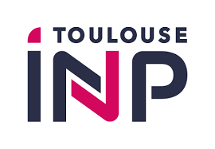
            

            

              L'<strong>ENSEEIHT</strong> (École Nationale Supérieure d'Électrotechnique, d'Électronique, d'Informatique, d'Hydraulique et des Télécommunications) is a leading public engineering school, recognised for its excellence in the field of fluid mechanics and sustainable technologies.
            

            Toulouse INP &bull; Department MF2E
          </aside>
        

      

    </section>

    <!-- ======================================================================
         SECTION 4 — ENGAGEMENTS ASSOCIATIFS (ERASMUS)
         ====================================================================== -->
    <section class="section section-alt" id="associatif" aria-labelledby="sec-04-title">
      

        

          03
          

            <h2 class="section-title" id="sec-04-title">Associative careers</h2>
          

        

        

          

            

              <h3 class="erasmus-project-title">Erasmus Seeds for tomorrow :</h3>
              

                European intercultural exchange project focused on ecology, sustainable development and the sharing of environmental solutions across Europe.
              

            

            

              <ul class="erasmus-activities-list" aria-label="Activités du programme Erasmus">
                <li class="erasmus-activity-item">
                  &bull;
                  Projects and activities focused on ecology
                </li>
                <li class="erasmus-activity-item">
                  &bull;
                  Hosting international students
                </li>
                <li class="erasmus-activity-item">
                  &bull;
                  Travel to Spain
                </li>
                <li class="erasmus-activity-item">
                  &bull;
                  Travel to Finland
                </li>
              </ul>

              <a href="https://www.instagram.com/erasmus_seeds_for_tomorrow/" target="_blank" rel="noopener noreferrer" class="editorial-link">
                Instagram @erasmus_seeds_for_tomorrow
                &nearr;
              </a>
            

          

          <!-- All 8 Authentic Erasmus Photos in Editorial Grid -->
          

            

              <figure class="img-frame">
                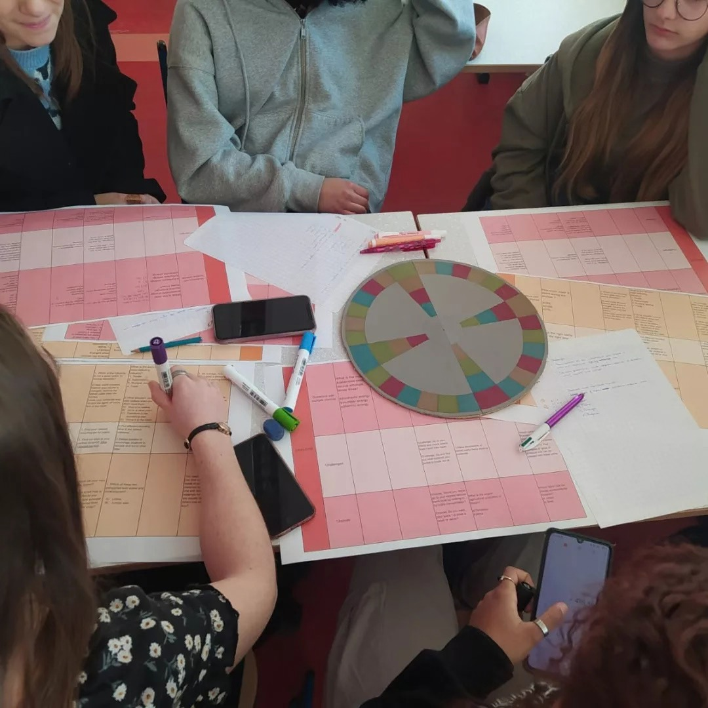
                Ecological collaborative workshop
              </figure>
              <figure class="img-frame">
                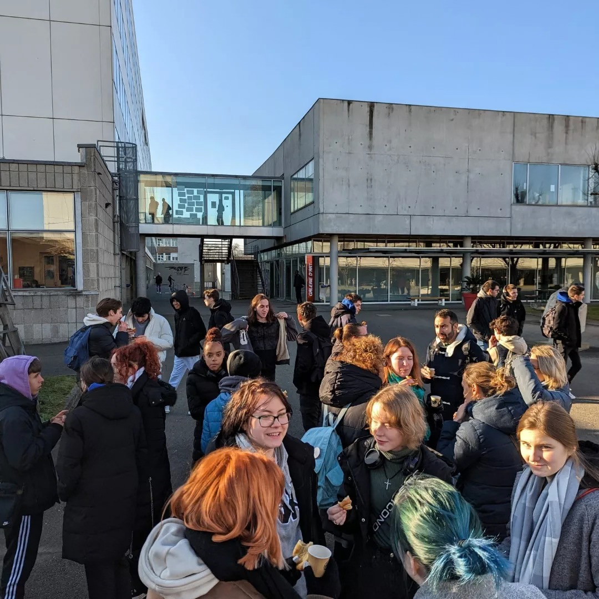
                European Student Exchange
              </figure>
              <figure class="img-frame">
                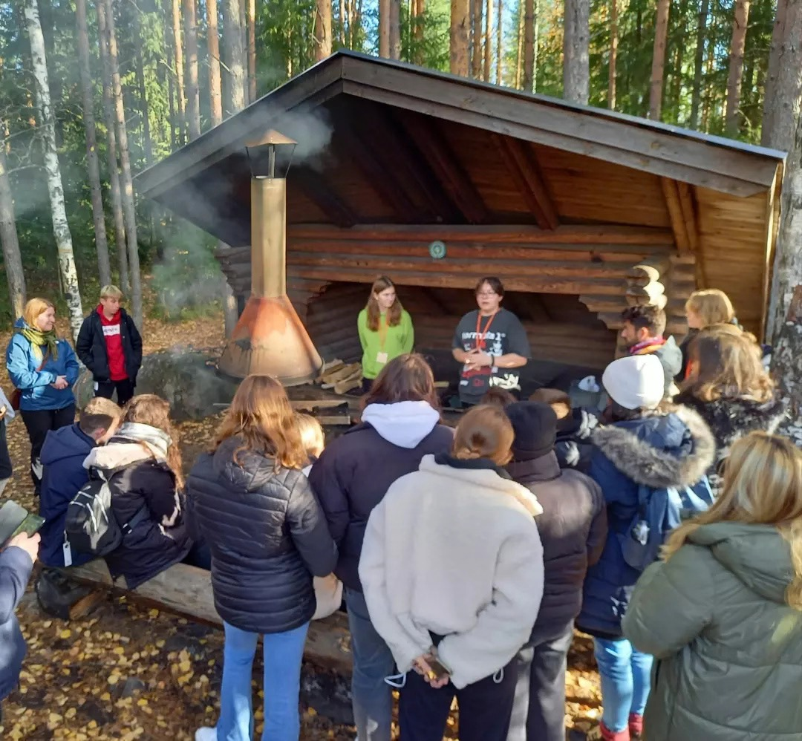
                Delegation Seeds for Tomorrow
              </figure>
              <figure class="img-frame">
                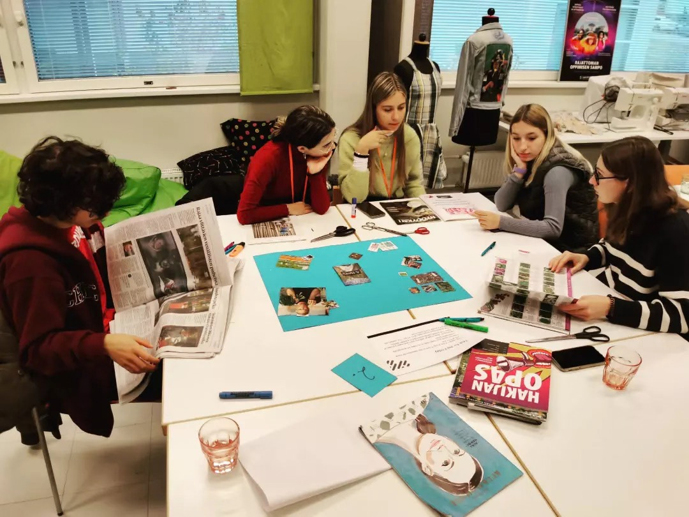
                Travel to Spain &bull; Field activities
              </figure>
              <figure class="img-frame">
                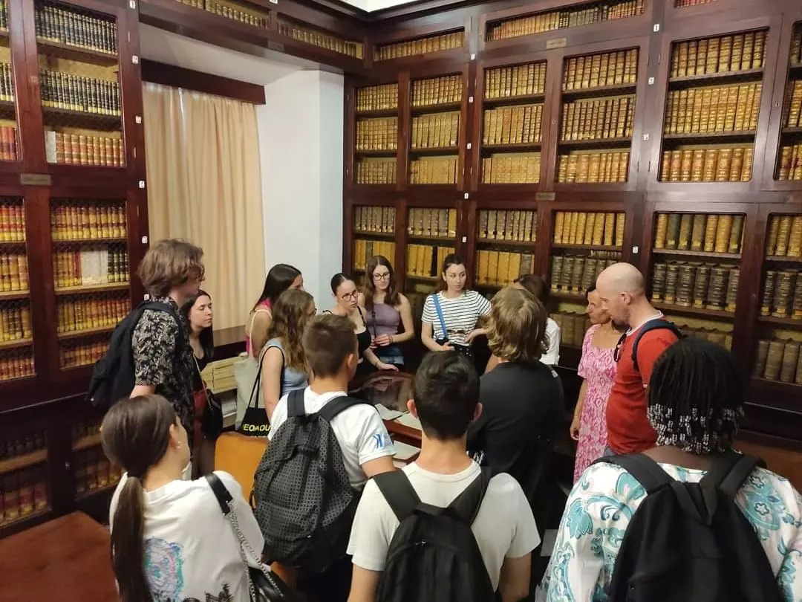
                Travel to Finland &bull; Cooperation
              </figure>
              <figure class="img-frame">
                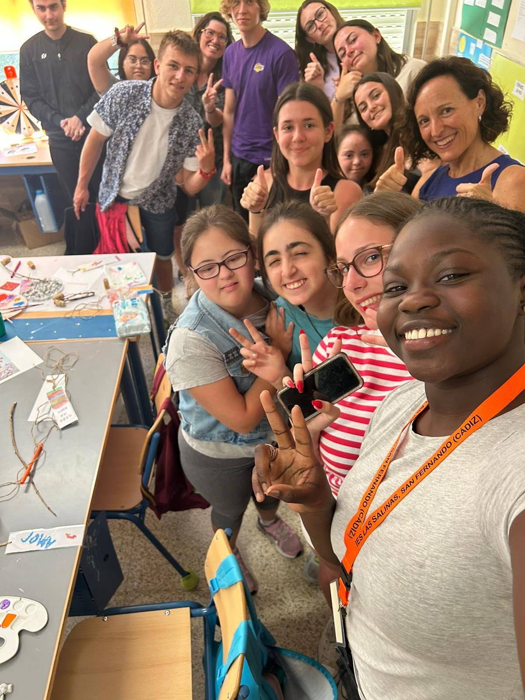
                Environmental Projects
              </figure>
              <figure class="img-frame">
                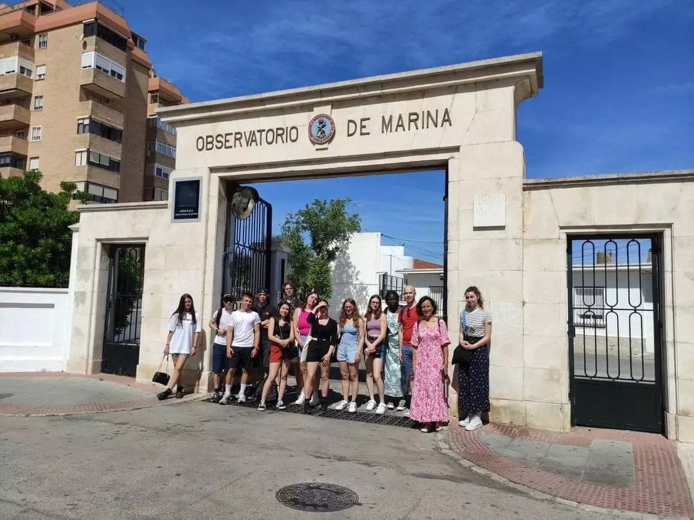
                Ecosystem studies
              </figure>
              <figure class="img-frame">
                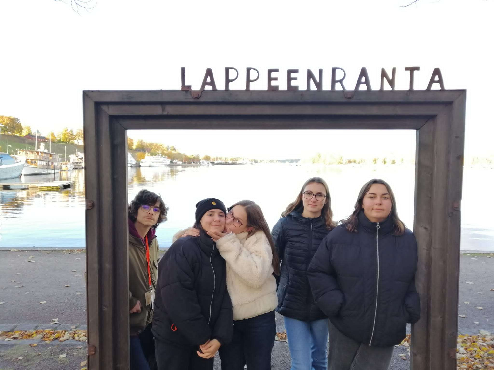
                Reception of foreign delegations
              </figure>
            

          

        

      

    </section>

    <!-- ======================================================================
         SECTION 5 — SNU (SERVICE NATIONAL UNIVERSEL)
         ====================================================================== -->
    <section class="section" id="snu" aria-labelledby="sec-05-title">
      

        

          04
          

            <h2 class="section-title" id="sec-05-title">SNU (Service National Universel) :</h2>
            Civic Engagement & Community Service Volunteering
          

        

        

          

            
            <h3 class="snu-heading">Cohesion stay</h3>
            

              Realization of a 12-day cohesion stay to understand national, European and international 
              institutions and to address societal issues such as secularism, discrimination, the ecological and solidarity transition, the commitment and mobility of young people, etc.
            

          

          

                  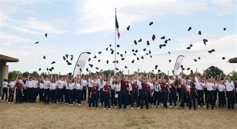
          

          

            
            <h3 class="snu-heading">Mission of general interest</h3>
            

              Realization of a mission of general interest within the TADAMOON association, developing the values of mutual aid, social cohesion and citizen solidarity.
            

            
            

              Association :
              <strong>TADAMOON</strong>
            

          

          

                  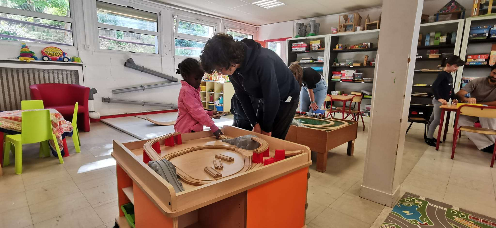
        
          

          

          
          
         
        

      

    </section>

    <!-- ======================================================================
         SECTION 6 — CLUBS & ASSOCIATIONS ENSEEIHT
         ====================================================================== -->
    <section class="section section-alt" id="clubs" aria-labelledby="sec-06-title">
      

        

          05
          

            <h2 class="section-title" id="sec-06-title">Future Club / Current Club :</h2>
            Student life &amp; associative involvement ENSEEIH
          

        

        <!-- Horizontal Editorial Row of Club Names -->
        

          CAN7 &mdash;
          PHOTO7 &mdash;
          7fe Place &mdash;
          Human7 &mdash;
          TVn7
        

        <!-- 5 Clubs Cards Grid with Authentic Logos & Placeholder for TVn7 -->
        

          <!-- Club 1: CAN7 -->
          <article class="club-card reveal">
            

              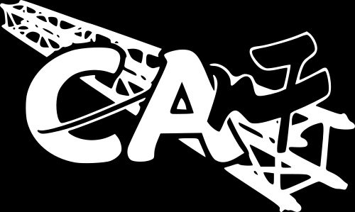
            

            01 / SOUND &amp; LIGHT
            <h3 class="club-name">CAN7</h3>
          </article>

          <!-- Club 2: PHOTO7 -->
          <article class="club-card reveal">
            

              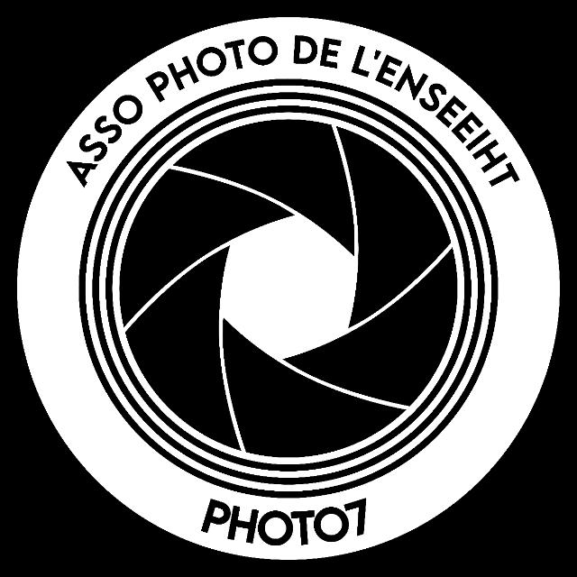
            

            02 / PHOTOGRAPHY
            <h3 class="club-name">PHOTO7</h3>
          </article>

          <!-- Club 3: 7fe Place -->
          <article class="club-card reveal">
            

              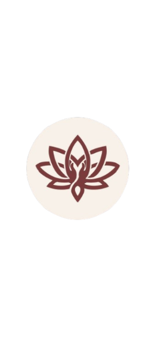
            

            03 / User-friendly &amp; SECURITY 
            <h3 class="club-name">7fe Place</h3>
          </article>

          <!-- Club 4: Human7 -->
          <article class="club-card reveal">
            

              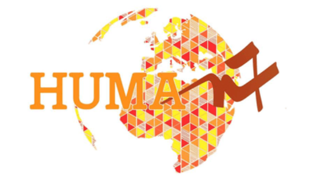
            

            04 / SOLIDARITY &amp; HUMANITARIAN
            <h3 class="club-name">Human7</h3>
          </article>

          <!-- Club 5: TVn7 (Placeholder for authentic/custom logo) -->
          <article class="club-card reveal">
            

              
            

            05 / MEDIA &amp; VIDEO
            <h3 class="club-name">TVn7</h3>
          </article>
        

      

    </section>

    <!-- ======================================================================
         SECTION 7 — TIPE / PROJET ACADÉMIQUE
         ====================================================================== -->
    <section class="section" id="projets" aria-labelledby="sec-07-title">
      

        

          06
          

            <h2 class="section-title" id="sec-07-title">TIPE :</h2>
            Supervised personal initiative work
          

        

        

          <!-- Meta Banner -->
          

            

              <h3 class="tipe-subject-title">Subject : Eddy Current Brakes</h3>
            

            

              

                Pair
                Louka Noël
              

              

                Physics Domains
                electromagnetism &amp; Mecanic
              

            

          

          <!-- Methodology Steps & Authentic Engineering Visual -->
          

            

              <!-- Step 1 -->
              <article class="tipe-step">
                01
                

                  <h3>Study of a pre-built model</h3>
                  
Study of a pre-built model with a rotating brake and the physical phenomenon of Eddy electromagnetic induction.

                

              </article>

              <!-- Step 2 -->
              <article class="tipe-step">
                02
                

                  <h3>Engine Bench Adaptation</h3>
                  
Adaptation of the model on an Engine Bench to quantify braking torques and associated energy dissipations.

                

              </article>

              <!-- Step 3 -->
              <article class="tipe-step">
                03
                

                  <h3>Creating a Linear Brake</h3>
                  
Creation of an A-Z model of a linear brake with experimental damping and deceleration measurements.

                

              </article>
            

            <!-- Authentic Figure + Maquettes TIPE -->
            

              <!-- Authentic TIPE Image from Canva -->
              

                <figure class="interest-photo-frame">
                  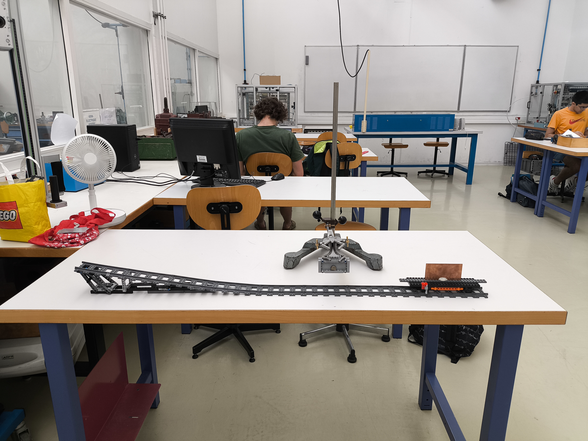
                </figure>
                Fig. 01 &mdash; Experimental test bench for eddy current linear brake
              

              <!-- Maquette 1 -->
              

                <figure class="interest-photo-frame">
                  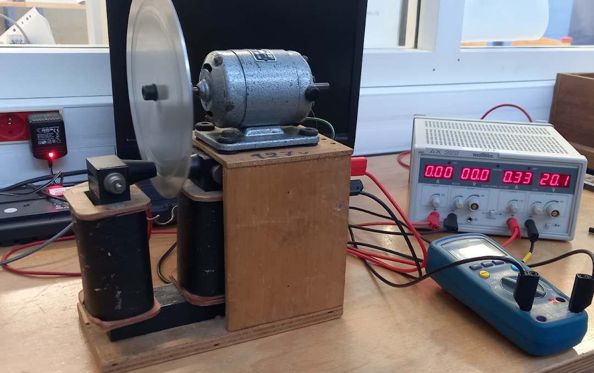
                </figure>
                Fig. 02 &mdash; First experimental model of the eddy current rotary brake
              

              <!-- Maquette 2 -->
              

                <figure class="interest-photo-frame">
                  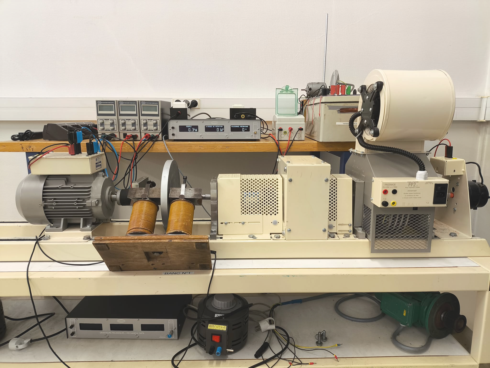
                </figure>
                Fig. 03 &mdash; Second experimental model of the eddy current rotary brake
              

            

          

        

      

    </section>

    <!-- ======================================================================
         SECTION 8 — CENTRES D'INTÉRÊT
         ====================================================================== -->
    <section class="section section-alt" id="interets" aria-labelledby="sec-08-title">
      

        

          07
          

            <h2 class="section-title" id="sec-08-title">Interests</h2>
            Sport, cultural activities &amp; Hobbies
          

        

        

          <!-- Column 1: Sport -->
          

            

              

                <h3 class="interest-title">Sport</h3>
              

              

                

                  
With ENSEEIHT :

                  
Handball, Fitness, Rock climbing, Dancing

                

                

                  
Before :

                  
8 years of Handball, 3 years of Dance, 1 year of athletics

                

              

            

            <!-- Placeholder for Sport Photo -->
            <!-- Sport Photo -->
            

              <figure class="interest-photo-frame">
                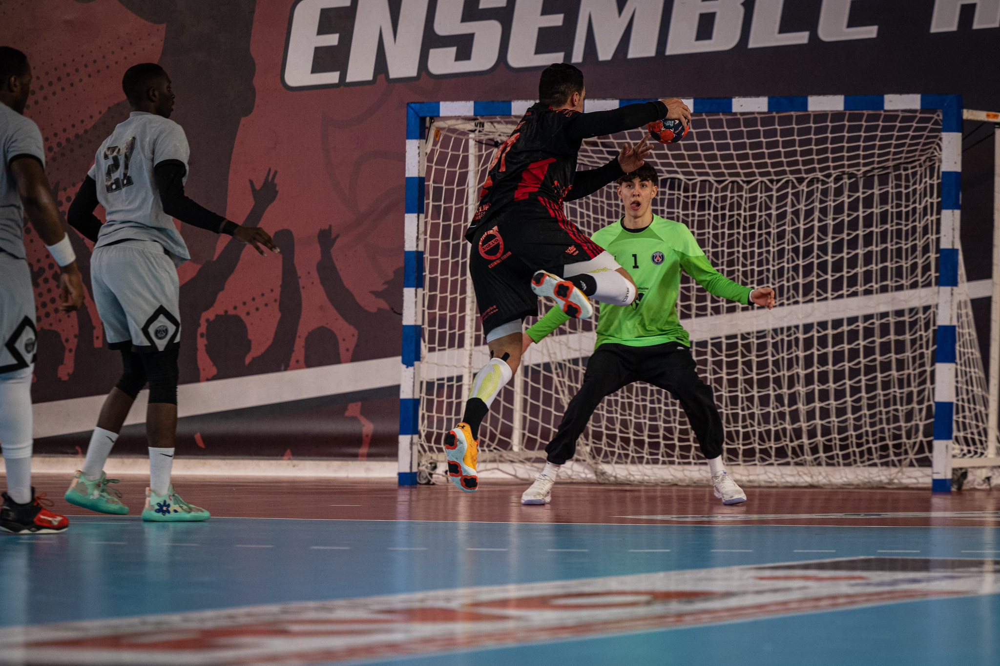
              </figure>
            

          

          <!-- Column 2: Activités & Loisirs -->
          

            

              

            
                <h3 class="interest-title">Activities</h3>
              

              

                Video/Board Games
                Reading
                Films/Series
                Youtube Video
                Politics
                Seeing my friends
                Learning
                Music
              

            

            <!-- Activities Photo -->
            

              <figure class="interest-photo-frame">
                
              </figure>
            

          

        

      

    </section>

    <!-- ======================================================================
         SECTION 9 — School engineering
         ====================================================================== -->
    <section class="section" id="courses" aria-labelledby="sec-08-title">
      

        

          08
          

            <h2 class="section-title" id="sec-08-title"> Engineering Classes :</h2>
          

        

        

          

            <h3 class="mobility-statement">
            1) TP Linear Elasticity : extensiometry 
            </h3>
            

              The Extensiometry lab consists of the study of the deformation of the material in the case of a tensile, with or without a hole in the specimen, and then a bending on a beam. 
              The material evaluated corresponded to aluminum.
            

          

          <!-- Photos TP Extensiométrie -->
          

            

              <figure class="tp-photo-frame">
                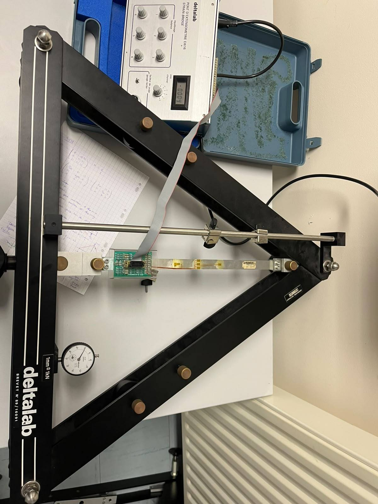
              </figure>
              Tensile specimen
            

            

              <figure class="tp-photo-frame">
                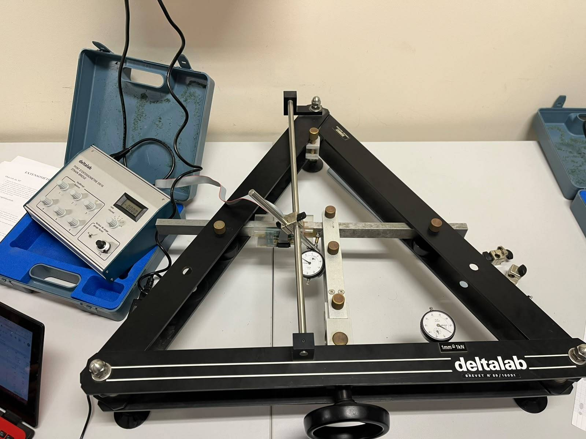
              </figure>
              Bending test bench
            

          

        

      

    </section>

    <!-- ======================================================================
         SECTION 10 — VIDÉO PRÉSENTATION
         ====================================================================== -->
    <section class="section section-alt" id="video" aria-labelledby="sec-video-title">
      

        

          09
          

            <h2 class="section-title" id="sec-video-title">Video Presentation</h2>
            Pitch &mdash; Personal presentation
          

        

        

          

            

              <iframe
              width="560"
              height="315"
              src="https://www.youtube.com/embed/o3GgsqsD92g"
              title="Lecteur vidéo YouTube"
              frameborder="0"
              allow="accelerometer; autoplay; clipboard-write; encrypted-media; gyroscope; picture-in-picture"
              allowfullscreen>
              </iframe>
            

          

        

      

    </section>

  </main>

  <!-- ========================================================================
       SECTION 11 — CONTACT & COLOPHON (FOOTER)
       ======================================================================== -->
  <footer class="section-contact" id="contact" role="contentinfo" aria-labelledby="sec-11-title">
    

      

        10
        

          <h2 class="section-title" id="sec-11-title">Contact</h2>
          Exchange &bull; Opportunities &bull; Network
        

      

      

      

        

          

            Email :
            <a href="mailto:jeremy.fremiot@laposte.net" class="contact-value editorial-link">
              Jeremy.fremiot@laposte.net
              &nearr;
            </a>
          

          

            Linkedin :
            <a href="https://www.linkedin.com/in/j%C3%A9r%C3%A9my-fr%C3%A9miot-74461a439?utm_source=share_via&utm_content=profile&utm_medium=member_android" target="_blank" rel="noopener noreferrer" class="contact-value editorial-link">
              Frémiot Jérémy
              &nearr;
            </a>
          

           

            Phone Number :
            <a  target="_blank" rel="noopener noreferrer" class="contact-value editorial-link">
              O6 13 33 94 87
              
            </a>

          

        

      

      <!-- Swiss Typography Colophon -->
      

        

          

            <strong>FRÉMIOT JÉRÉMY</strong> &mdash; Engineering Portfolio . 
            Student Toulouse INP ENSEEIHT, Class 2029.
          

        

        

          <a href="#hero" class="editorial-link" aria-label="Remonter en haut de page">
            Top of page
            &uarr;
          </a>
        

      

    

  </footer>

  <!-- Scripts -->
  
</body>
</html>
